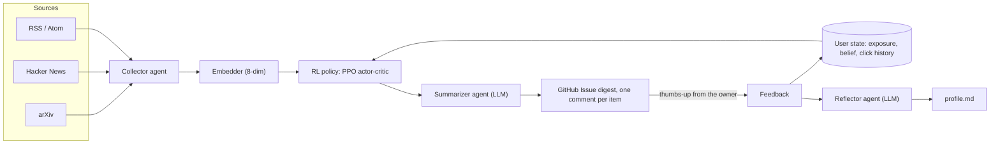
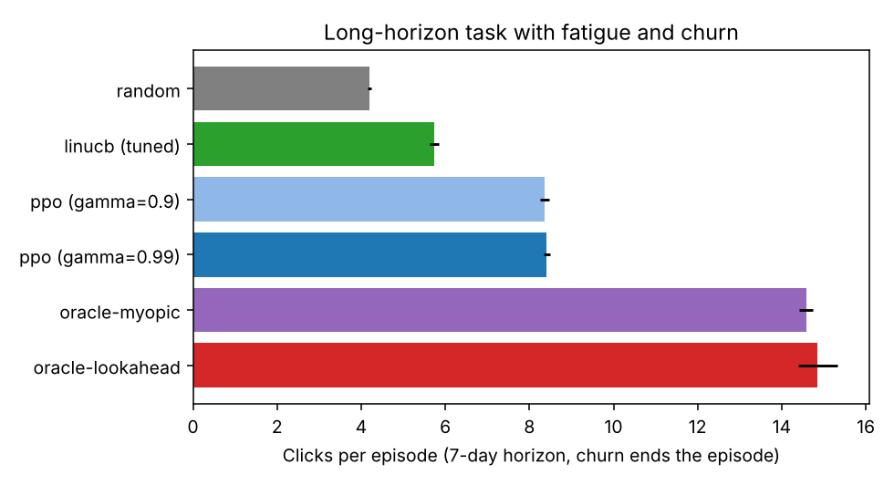

# Curio

**A multi-agent feed curator that learns your taste with reinforcement learning, and an honest study of when RL actually helps.**

Curio collects papers and articles every day, picks a small slate with a PPO actor-critic
policy, summarizes it with an LLM agent, and learns from your thumbs-up reactions. The
repository contains both the working pipeline and a simulation study that tests whether
RL is really better than a well-tuned contextual bandit for this task.

> **Status: research prototype.** The RL study is complete and reproducible. The live
> pipeline is tested offline and against the real GitHub API, but has **not yet been run
> against live arXiv / Hacker News / Anthropic APIs or on GitHub Actions** (see
> [Limitations](#limitations)).

## Architecture



**The decision problem (MDP) used for training** (`curio.env_longterm.LongTermFeedEnv`):

| Element | Definition |
|---|---|
| State | Exposure to recent items, clicked/skipped history, a running belief about the user's interest, day-level CTR history, and the 30 candidate items |
| Action | Pick one candidate at a time until the day's slate (5 items) is full |
| Reward | Clicks only |
| Transition | Showing similar items causes fatigue that carries across days; interest drifts toward clicked items; the user **churns** (episode ends) if satisfaction drops too low |
| Discount | gamma = 0.99 over a 7-day horizon |

## Key findings

All numbers are means over 3 seeds unless stated, evaluated on simulated users the
policy never saw in training. Details, tables and plots are under
[Experiments in detail](#experiments-in-detail).

| # | Setting | Result |
|---|---|---|
| 1 | One-day slates, no click feedback (5 seeds) | PPO 4.77 vs LinUCB 4.44 vs random 3.45. PPO won on all seeds, but it had learned a **user-agnostic diversity strategy**, not personalization. |
| 2 | New user every episode, click feedback | Click feedback helps PPO, but a **tuned LinUCB ties it** (6.92 vs 6.97). An earlier "PPO wins" claim came from an untuned baseline and was corrected. |
| 3 | 7-day horizon with fatigue and churn | PPO (8.4 clicks) beats a fatigue-unaware bandit (5.7), but a **fatigue-aware bandit scores 11.7**. The "RL win" was largely an information gap. |
| 4 | Same task, PPO with similarity features and longer training (2 seeds, preliminary) | 11.8 vs 11.9 for the fatigue-aware bandit on the same seeds: **roughly a tie**. Oracle ceiling is about 14.8. |

**Take-away.** In these simulators RL is competitive with a well-tuned, well-informed
bandit, but no setting showed it clearly winning. The RL advantages seen early on were
explained by the baselines lacking information (novelty, click feedback, fatigue) or
tuning, and there was no sign of a benefit from long-horizon planning: changing the
discount from 0.9 to 0.99 made no difference, and a lookahead oracle was barely better
than a myopic one. This does not prove RL cannot win; harder or longer-horizon
settings remain untested. Corrected results are documented in the git history rather
than hidden.

**Method notes.** Baselines are tuned on separate validation seeds (never the evaluation
seeds), with grid search extended until the optimum is interior. Methods are compared on
identical evaluation users per seed with paired differences, and each claim lists the
number of seeds. Earlier results remain reproducible via the tag
`v0.1-no-click-feedback`.

## Quick start

```bash
git clone https://github.com/MHanzala74/Curio && cd Curio
python -m venv .venv && source .venv/bin/activate
pip install -r requirements.txt
PYTHONPATH=src pytest -q                              # 52 tests

# Live pipeline demo, offline, with bundled synthetic items:
export PYTHONPATH=src
python -m curio.cli daily --demo --offline
python -m curio.cli feedback --clicked 1 3
python -m curio.cli reflect --offline
```

## Experiments in detail

### Results (simulated user, 5 seeds)


Each seed trains a fresh PPO agent and evaluates every method on 300 episodes
with a **different simulated user** than the one used in training:

| Method | Mean episode return (mean ± std over 5 seeds) | CTR |
|---|---|---|
| random | 3.454 ± 0.038 | 0.443 ± 0.007 |
| linucb-bandit | 4.443 ± 0.049 | 0.701 ± 0.011 |
| oracle-greedy | 4.450 ± 0.030 | 0.706 ± 0.007 |
| ppo (ours) | 4.765 ± 0.057 | 0.706 ± 0.012 |

Paired difference (PPO - LinUCB): +0.323 ± 0.044; PPO wins on 5/5 seeds.

Reproduce with:

```bash
PYTHONPATH=src python multi_seed.py --seeds 5
```

#### What PPO actually learned (important)

PPO beats the greedy baselines on all 5 seeds, but the reason is **not
personalization**. In the current environment the observation only contains the
items that were shown, not whether the user clicked them, so the policy cannot
infer a user's taste. A diagnostic run confirmed this: the trained policy keeps
a click-through rate of about 0.69 on a user whose interest vector has cosine
similarity -0.5 with the training user.

What it learned instead is a **diversity strategy**: showing items that are
dissimilar to each other lowers the simulated user's boredom and earns the
novelty bonus, something the one-step greedy baselines ignore. That is a real
sequential effect, but it is a user-agnostic one.

**Other caveats**

- The simulated user is simple, so these numbers say little about a real person.
- Oracle-greedy peeks at the true interest and ignores novelty; it is a
  reference point, not a fair competitor.
- The follow-up experiment below adds click feedback to the observation.
- These results were produced with the code at tag `v0.1-no-click-feedback`.

### Personalization experiment


To test real personalization, every episode uses a **brand-new simulated user**
and a slate of 10 items, so a policy cannot memorize one user. Three PPO
variants differ only in what they observe:

- **no click feedback**: sees only which items were shown
- **click feedback**: also sees summaries of clicked and skipped items
- **click feedback + belief state**: also sees a running ridge-regression
  estimate of the user's interest (clicks = +1, skips = -1)

The per-user LinUCB baseline was tuned on separate validation seeds (100-102,
never the evaluation seeds) over three rounds of grid search until the optimum
was interior (`alpha=2.0, reg=0.1`, skips counted as negative evidence; see
`tune_linucb.py`). An untuned version is shown for reference.

| Method | Episode return (mean ± std, 3 seeds) | CTR |
|---|---|---|
| random | 6.048 ± 0.029 | 0.401 |
| linucb (untuned) | 6.116 ± 0.080 | 0.445 |
| ppo (no click feedback) | 6.642 ± 0.034 | 0.428 |
| ppo (with click feedback) | 6.894 ± 0.109 | 0.467 |
| linucb (tuned) | 6.915 ± 0.065 | 0.468 |
| ppo (click feedback + belief state) | 6.974 ± 0.069 | 0.468 |
| oracle-greedy | 7.554 ± 0.088 | 0.597 |
| oracle-diverse | 7.979 ± 0.093 | 0.614 |

Paired differences (same evaluation users and pools per seed):
- ppo (with click feedback) minus ppo (no click feedback): +0.252 ± 0.075 (ppo (with click feedback) wins on 3/3 seeds)
- ppo (click feedback + belief state) minus ppo (with click feedback): +0.080 ± 0.056 (ppo (click feedback + belief state) wins on 3/3 seeds)
- ppo (click feedback + belief state) minus linucb (tuned): +0.059 ± 0.069 (ppo (click feedback + belief state) wins on 2/3 seeds)
- ppo (with click feedback) minus linucb (tuned): -0.021 ± 0.067 (ppo (with click feedback) wins on 1/3 seeds)

Reproduce with:

```bash
PYTHONPATH=src python tune_linucb.py
for v in baselines noclick click belief; do
  PYTHONPATH=src python personalization.py --variant $v --seeds 0 1 2
done
python aggregate.py
```

**Reading these results honestly**

- Click feedback clearly helps PPO (+0.25 return, 3/3 seeds), so the agent does
  learn some personalization from in-episode clicks.
- **A properly tuned bandit matches PPO.** PPO with the belief state is +0.06
  over tuned LinUCB, with a standard deviation of 0.07 over 3 seeds, which is
  not a meaningful difference. An earlier version of this README reported a large
  PPO advantage over LinUCB; that came from comparing against an untuned
  baseline (6.12) and has been removed.
- The belief state adds a small gain (+0.08, within noise at 3 seeds).
- Both PPO and tuned LinUCB are still far from the oracles (CTR 0.47 vs 0.60),
  so most of the personalization gap is not yet closed. The oracles know the
  true interest, so they are references, not fair competitors.
- Only 3 seeds, one simulator, and 10 interactions per user.

**Where this leaves the RL claim:** in this simulator, the sequential structure
matters mostly through diversity and boredom, and a tuned contextual bandit
captures most of the achievable gain with very little data. A fairer test of RL's
advantage needs longer horizons, where today's choices change later states more.

### Long-horizon experiment (fatigue and churn)



The previous task rewarded one-day decisions. Here an episode is up to **7 days**
with a new user each episode (`curio.env_longterm.LongTermFeedEnv`):

- Reward is **only clicks**, so diversity matters only if it keeps the user around.
- Fatigue: showing items similar to recent exposure lowers click probability, and
  the effect carries across days.
- The user's interest drifts toward clicked items.
- If satisfaction (a running average of daily CTR) drops below a threshold, the
  user **churns** and the episode ends, losing all future clicks.

PPO sees what it showed (so it can track exposure), clicks and skips, a belief
about the user's interest, and day-level CTR history. Two LinUCB baselines are
included, both tuned on separate validation seeds:

- **linucb (tuned)**: per-user bandit that ignores fatigue.
- **linucb (fatigue-aware)**: the same bandit plus a penalty on items similar to
  its own running exposure vector (computed from the items it showed, never from
  hidden user state). Its hyperparameters were tuned over three rounds of grid
  search until the best setting had worse neighbours on every side.

| Method | Return (clicks per episode, mean ± std, 3 seeds) | Days before churn (max 7) |
|---|---|---|
| random | 4.20 ± 0.04 | 2.20 |
| linucb (tuned) | 5.74 ± 0.11 | 2.67 |
| ppo (gamma=0.9) | 8.36 ± 0.10 | 3.44 |
| ppo (gamma=0.99) | 8.41 ± 0.08 | 3.46 |
| linucb (fatigue-aware) | 11.70 ± 0.34 | 4.31 |
| oracle-myopic | 14.59 ± 0.16 | 5.06 |
| oracle-lookahead | 14.85 ± 0.47 | 5.11 |

Paired differences (same evaluation users per seed):
- ppo (gamma=0.99) minus linucb (tuned): +2.68 ± 0.17 (first wins on 3/3 seeds)
- linucb (fatigue-aware) minus ppo (gamma=0.99): +3.28 ± 0.30 (first wins on 3/3 seeds)
- linucb (fatigue-aware) minus linucb (tuned): +5.96 ± 0.36 (first wins on 3/3 seeds)
- ppo (gamma=0.99) minus ppo (gamma=0.9): +0.05 ± 0.17 (first wins on 2/3 seeds)
- oracle-lookahead minus oracle-myopic: +0.27 ± 0.50 (first wins on 2/3 seeds)

Share of the random-to-oracle-lookahead gap closed: PPO 40%, fatigue-aware LinUCB 70%.

Reproduce with:

```bash
for v in baselines ppo90 ppo99; do
  PYTHONPATH=src python long_horizon.py --variant $v --seeds 0 1 2
done
python aggregate_long.py
```

**Reading these results honestly**

- Against a fatigue-unaware bandit, PPO looks strong (+2.7 clicks per episode).
  That comparison was misleading: **a bandit with a simple fatigue penalty beats
  PPO by +3.3 clicks per episode on all 3 seeds** and closes about 70% of the gap to
  the oracles, versus 40% for PPO. Most of PPO's earlier advantage was the
  fatigue information, not reinforcement learning as such.
- Changing the discount from 0.9 to 0.99 made no difference (+0.05 ± 0.17), and the
  lookahead oracle is only marginally better than the myopic one (+0.27 ± 0.50).
  In this simulator, planning ahead adds little beyond avoiding fatigue.
- PPO's training curves were still improving after 200 updates, so a longer run
  or a better-suited architecture might narrow the gap. This has not been tested
  yet, so the result is "PPO at this training budget loses to a good heuristic",
  not "RL cannot win here".
- Three seeds, one simulator with hand-chosen constants.


#### Follow-up: giving PPO a fair second chance (preliminary, 2 seeds)

PPO was retrained for 400 updates with explicit similarity features
(`item . summary` and its ReLU, which make terms like `max(0, item . exposure)` easy
to represent; `ActorCritic(dot_features=True)`). Long runs use checkpoint/resume
(`train_ppo_chunked`) to fit tool time limits.

| Seed | PPO (dot features, 400 updates) | LinUCB (fatigue-aware) |
|---|---|---|
| 0 | 11.49 | 11.65 |
| 1 | 12.04 | 12.06 |

With the right features and more training, PPO goes from 8.4 to roughly the level of
the tuned fatigue-aware bandit. Only 2 seeds were run, so this is preliminary: it
shows the earlier gap was largely about features and training budget, not that PPO
beats the bandit. The research track is paused here to build the live pipeline.

## Live pipeline (multi-agent)

Curio now runs on real content. Three agents cooperate with the trained RL policy:

| Component | Role |
|---|---|
| **Collector agent** (`curio.collector`) | Fetches candidates from arXiv, Hacker News and any RSS/Atom feeds. One failing source never stops the run. |
| **Policy** (`curio.live`, `models/curio_policy.pt`) | The PPO actor-critic trained on the long-horizon simulator picks the daily slate from the shortlist. |
| **Summarizer agent** (`curio.agents`) | Writes a two-sentence summary per picked item (LLM, with an extractive fallback). |
| **Reflector agent** (`curio.agents`) | Turns your click history into a readable `profile.md` (LLM, with a keyword fallback). |

```bash
# Try it offline with bundled synthetic items (no network, no API key):
python -m curio.cli daily --demo --offline
python -m curio.cli feedback --clicked 1 3     # item numbers from today's digest
python -m curio.cli reflect --offline          # writes profile.md

# Real run (needs network; set ANTHROPIC_API_KEY for LLM summaries and profiles):
pip install anthropic            # optional, for the LLM agents
python -m curio.cli daily
```

Items you do not click count as ignored. Optional extras: `anthropic` (LLM agents) and
`sentence-transformers` (`--embedder sbert`); the default hashing embedder works offline.
Item text from the internet is treated as untrusted data in all prompts.

**What is and is not verified**

- Verified by tests: parsers on fixture feeds, de-duplication, graceful fallbacks, and
  that the live observation matches the simulator's observation **exactly**
  (`tests/test_live.py`), plus an offline end-to-end run of daily, feedback and reflect.
- **Not yet tested against the live arXiv / Hacker News APIs or the Anthropic API**, which
  were not reachable from the development sandbox. Expect to fix small issues on first run.
- The policy was trained on a simulator with 8-dimensional synthetic items. Real text is
  embedded into 8 dimensions with a hashing embedder, which is crude, and slates are built
  open loop (no click feedback between items of one digest). In the offline demo some
  digests contain near-duplicate topics. **There is no evaluation yet of how well the live
  ranking matches a real person's taste**; that needs real feedback over several weeks.
- `models/curio_policy.pt` is the seed-0 checkpoint of the PPO run with similarity features.

## Daily automation (GitHub Actions + Issue reactions)

The workflow in `deploy/daily.yml` runs the whole loop once a day (04:00 UTC):

1. `sync-feedback`: read your thumbs-up reactions on yesterday's digest issue, update the
   policy's user state, close the issue.
2. `daily`: collect, shortlist, pick the slate with the RL policy, summarize.
3. `publish`: open a new issue "Curio digest YYYY-MM-DD" with **one comment per item**.
4. On Sundays, `reflect` refreshes `profile.md`; then state and digests are committed.

**Giving feedback:** put a thumbs-up on the comment of every item you want more of.
Items without a thumbs-up count as ignored. Only reactions from the repository owner are
counted (`--feedback-user` changes that), so strangers cannot steer the model on a public
repo. Text from the internet is also stripped of `@mentions` before it is posted.

**Setup**

0. Copy `deploy/daily.yml` to `.github/workflows/daily.yml`. It is kept outside
   `.github/` on purpose: GitHub refuses pushes that add workflow files unless the token
   has the `workflow` scope, so the simplest way is the web UI (Add file > Create new
   file > path `.github/workflows/daily.yml`, paste, commit) or a normal `git push` from
   your own machine, where you are logged in with full permissions.
1. Settings > Secrets and variables > Actions > **Variables**: add `CURIO_ENABLED` = `true`
   (the workflow does nothing until you opt in).
2. Optional: add the **secret** `ANTHROPIC_API_KEY` for LLM summaries and profiles.
3. Actions tab > "Curio daily digest" > **Run workflow** once to test it.

**Privacy warning:** the workflow commits `state/live_state.json` and `digest/`, which
contain what you were shown and clicked. In a public repository that is your reading
history. For personal use, run it in a **private copy** of this repository.

**What is and is not verified**

- Verified against the real GitHub API: a smoke test (create issue, comments, owner
  reaction, read reactions, close) and a rehearsal of the workflow's CLI sequence
  (`sync-feedback`, `daily --demo`, `publish`, reaction, `sync-feedback`) with the same
  environment variables the workflow uses. Owner thumbs-up is detected, other users are
  ignored. The remaining logic is covered by tests using an in-memory fake of the API.
- The commit step lives in `deploy/commit_state.sh` and has regression tests in a real git
  repository. An earlier version of the workflow silently committed nothing until
  `profile.md` existed; that bug was found by inspection and fixed.
- `deploy/daily.yml` passes `actionlint`, but **it has never been executed on GitHub
  Actions**. Expect to adjust it after the first run (for example Python/torch install time).
- GitHub may pause scheduled workflows in repositories with no recent activity, and cron
  start times can drift by several minutes.

## Limitations

- **Simulation only for the RL claims.** The simulated user is simple and its constants
  (fatigue, drift, churn threshold) were chosen by hand. Results say little about how a
  real person behaves.
- **Small number of seeds** (3, and 2 for the last follow-up), so standard deviations are
  rough and small gaps are not meaningful.
- **Sim-to-real gap in the live pipeline.** The policy was trained on 8-dimensional
  synthetic items; real text is mapped to 8 dimensions with a crude hashing embedder, and
  daily slates are built open loop (no click feedback between items of one digest).
- **No evaluation with real feedback yet.** Whether the live ranking matches a real
  person's taste needs several weeks of actual use.
- **Untested integrations.** The arXiv, Hacker News and Anthropic API calls and the GitHub
  Actions workflow have not been run end to end; the GitHub Issues feedback loop was
  verified with a real smoke test and an in-memory fake.
- **Privacy.** The daily workflow commits your click history. Run it in a private copy.

## Project layout

```
src/curio/
  env.py, env_longterm.py     simulation environments (one-day and 7-day with churn)
  simulated_user.py           drifting user model for the one-day environment
  ppo.py, training.py         PPO actor-critic from scratch, chunked/resumable training
  baselines.py, evaluate.py   random, oracles, LinUCB (tuned, fatigue-aware), evaluation
  collector.py                Collector agent: arXiv, Hacker News, RSS/Atom
  embedding.py                hashing and sentence-transformer embedders
  agents.py, llm.py           Summarizer and Reflector agents, LLM client
  live.py, github_io.py       live user state, slate builder, GitHub Issue feedback
  cli.py                      daily / publish / sync-feedback / feedback / reflect
models/curio_policy.pt        trained policy weights (seed-0 PPO run)
deploy/daily.yml              GitHub Actions workflow template
docs/                         result tables, plots, per-seed run files
*.py (repo root)              experiment scripts: multi_seed, personalization, long_horizon, ...
tests/                        52 tests
```

## Roadmap

- [x] Simulator, PPO from scratch, baselines, multi-seed evaluation
- [x] Personalization and long-horizon studies with tuned, fair baselines
- [x] Collector, Summarizer and Reflector agents; live slate builder and CLI
- [x] GitHub Issue reaction feedback and a daily workflow template
- [ ] First real run against live APIs and on GitHub Actions
- [ ] Several weeks of real feedback to evaluate the live ranking
- [ ] Better item embeddings and a policy retrained on realistic features
- [ ] Closed-loop feedback per item, or retraining on logged real feedback
- [ ] More seeds for the PPO-vs-bandit follow-up

## Running the tests

```bash
PYTHONPATH=src pytest -q
```

## License

MIT
