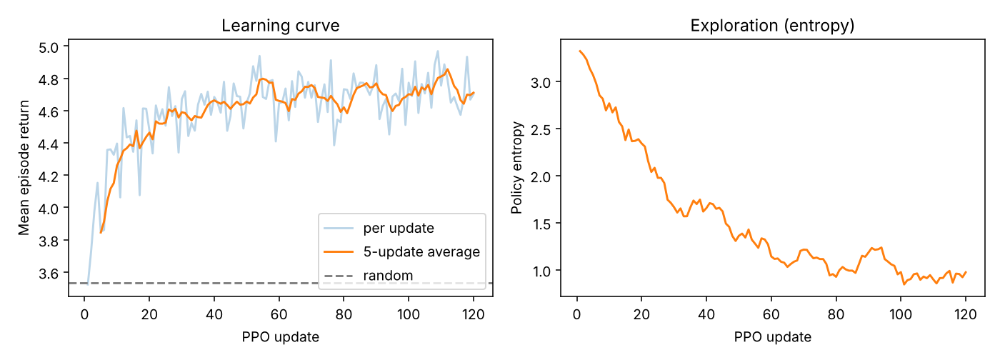

# curio-rl

A multi-agent news feed curator that learns **your** taste using real
reinforcement learning (PPO actor-critic), not just a bandit.

> Status: early development. Built in small steps, one commit at a time.

## Idea

Every day the system collects many candidate items (papers, blog posts,
repos), picks a small slate to show you, and learns from how you react.
Because what we show today shapes your interests tomorrow, this is a
sequential decision problem, which is exactly what RL is for.

## MDP formulation

| Element    | Definition                                                                 |
|------------|----------------------------------------------------------------------------|
| State      | User interest vector, recent history summary, candidate pool features      |
| Action     | Pick one candidate item at a time until the slate is full (slate building) |
| Reward     | Engagement (click, read time) + novelty bonus - redundancy penalty         |
| Transition | The user's interests drift toward what they were shown and liked           |
| Discount   | gamma = 0.9, so long-term satisfaction matters, not just instant clicks    |

## Planned architecture

- **Collector agent**: fetches candidate items from several sources
- **Simulated user**: used to pretrain the policy with thousands of episodes
- **Policy (PPO actor-critic)**: decides which items to show
- **Summarizer agent**: writes short summaries for the chosen items
- **Reflector agent**: writes a weekly natural-language profile of your taste

## Roadmap

- [x] Project scaffold
- [x] Gymnasium environment and simulated user
- [x] PPO implementation (PyTorch) and baselines (random, greedy, bandit)
- [x] Learning curves and first comparison table (single seed)
- [ ] Real feedback pipeline
- [ ] LLM agents (collector, summarizer, reflector)
- [ ] GitHub Actions daily run

## Getting started

```bash
python -m venv .venv && source .venv/bin/activate
pip install -r requirements.txt
```

## License

MIT

## Results (simulated user)



Evaluated on 300 fresh episodes with the same seed for every method:

| Method | Mean episode return | Click-through rate |
|---|---|---|
| random | 3.535 | 0.461 |
| linucb-bandit | 4.530 | 0.719 |
| oracle-greedy | 4.565 | 0.729 |
| ppo (ours) | 4.659 | 0.679 |

Reproduce with:

```bash
PYTHONPATH=src python train.py --updates 120
```

**Honest notes**

- This is a **single seed** and the gaps between PPO, LinUCB and the oracle are
  small, so they are not statistically meaningful yet. Multi-seed runs with
  confidence intervals are the next step.
- PPO beating the bandit is mostly explained by the reward including a novelty
  term, which a one-step bandit cannot optimize. The simulated user is simple,
  so these numbers say little about performance on a real person.
- The oracle-greedy policy peeks at the true user interest, so it is a
  reference point, not a fair competitor.

## Running the tests

```bash
PYTHONPATH=src pytest -q
```
