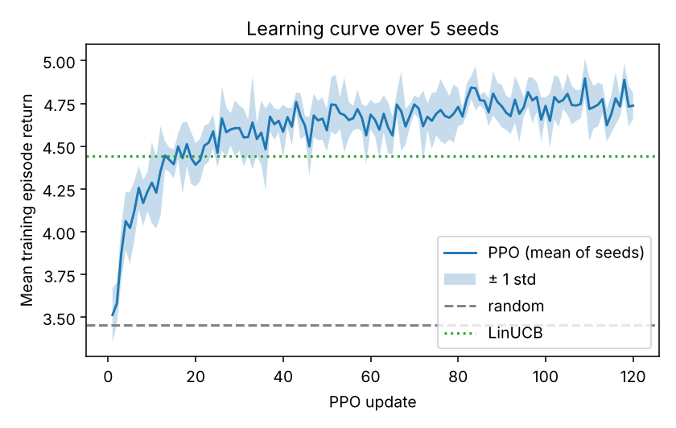
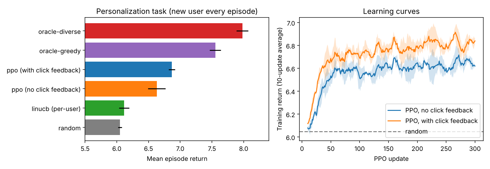

# Curio

**An AI feed curator that learns your taste.**

A multi-agent news feed curator that learns **your** taste using real
reinforcement learning (PPO actor-critic), not just a bandit.

> Status: early development. Built in small steps, one commit at a time.

## Idea

Every day the system collects many candidate items (papers, blog posts,
repos), picks a small slate to show you, and learns from how you react.
Because what we show today shapes your interests tomorrow, this is a
sequential decision problem, which is exactly what RL is for.

## MDP formulation

| Element    | Definition                                                                 |
|------------|----------------------------------------------------------------------------|
| State      | User interest vector, recent history summary, candidate pool features      |
| Action     | Pick one candidate item at a time until the slate is full (slate building) |
| Reward     | Engagement (click, read time) + novelty bonus - redundancy penalty         |
| Transition | The user's interests drift toward what they were shown and liked           |
| Discount   | gamma = 0.9, so long-term satisfaction matters, not just instant clicks    |

## Planned architecture

- **Collector agent**: fetches candidate items from several sources
- **Simulated user**: used to pretrain the policy with thousands of episodes
- **Policy (PPO actor-critic)**: decides which items to show
- **Summarizer agent**: writes short summaries for the chosen items
- **Reflector agent**: writes a weekly natural-language profile of your taste

## Roadmap

- [x] Project scaffold
- [x] Gymnasium environment and simulated user
- [x] PPO implementation (PyTorch) and baselines (random, greedy, bandit)
- [x] Learning curves and multi-seed comparison (5 seeds, mean ± std)
- [x] Expose click feedback in the observation so the policy can personalize (partial success, see below)
- [x] Tuned LinUCB baseline and belief-state PPO variant
- [x] Longer-horizon task with fatigue and churn
- [x] Fatigue-aware bandit baseline (it beats PPO at the current training budget)
- [ ] Longer PPO training / better architecture, more seeds
- [ ] Real feedback pipeline
- [ ] LLM agents (collector, summarizer, reflector)
- [ ] GitHub Actions daily run

## Getting started

```bash
python -m venv .venv && source .venv/bin/activate
pip install -r requirements.txt
```

## License

MIT

## Results (simulated user, 5 seeds)



Each seed trains a fresh PPO agent and evaluates every method on 300 episodes
with a **different simulated user** than the one used in training:

| Method | Mean episode return (mean ± std over 5 seeds) | CTR |
|---|---|---|
| random | 3.454 ± 0.038 | 0.443 ± 0.007 |
| linucb-bandit | 4.443 ± 0.049 | 0.701 ± 0.011 |
| oracle-greedy | 4.450 ± 0.030 | 0.706 ± 0.007 |
| ppo (ours) | 4.765 ± 0.057 | 0.706 ± 0.012 |

Paired difference (PPO - LinUCB): +0.323 ± 0.044; PPO wins on 5/5 seeds.

Reproduce with:

```bash
PYTHONPATH=src python multi_seed.py --seeds 5
```

### What PPO actually learned (important)

PPO beats the greedy baselines on all 5 seeds, but the reason is **not
personalization**. In the current environment the observation only contains the
items that were shown, not whether the user clicked them, so the policy cannot
infer a user's taste. A diagnostic run confirmed this: the trained policy keeps
a click-through rate of about 0.69 on a user whose interest vector has cosine
similarity -0.5 with the training user.

What it learned instead is a **diversity strategy**: showing items that are
dissimilar to each other lowers the simulated user's boredom and earns the
novelty bonus, something the one-step greedy baselines ignore. That is a real
sequential effect, but it is a user-agnostic one.

**Other caveats**

- The simulated user is simple, so these numbers say little about a real person.
- Oracle-greedy peeks at the true interest and ignores novelty; it is a
  reference point, not a fair competitor.
- The follow-up experiment below adds click feedback to the observation.
- These results were produced with the code at tag `v0.1-no-click-feedback`.

## Personalization experiment



To test real personalization, every episode uses a **brand-new simulated user**
and a slate of 10 items, so a policy cannot memorize one user. Three PPO
variants differ only in what they observe:

- **no click feedback**: sees only which items were shown
- **click feedback**: also sees summaries of clicked and skipped items
- **click feedback + belief state**: also sees a running ridge-regression
  estimate of the user's interest (clicks = +1, skips = -1)

The per-user LinUCB baseline was tuned on separate validation seeds (100-102,
never the evaluation seeds) over three rounds of grid search until the optimum
was interior (`alpha=2.0, reg=0.1`, skips counted as negative evidence; see
`tune_linucb.py`). An untuned version is shown for reference.

| Method | Episode return (mean ± std, 3 seeds) | CTR |
|---|---|---|
| random | 6.048 ± 0.029 | 0.401 |
| linucb (untuned) | 6.116 ± 0.080 | 0.445 |
| ppo (no click feedback) | 6.642 ± 0.034 | 0.428 |
| ppo (with click feedback) | 6.894 ± 0.109 | 0.467 |
| linucb (tuned) | 6.915 ± 0.065 | 0.468 |
| ppo (click feedback + belief state) | 6.974 ± 0.069 | 0.468 |
| oracle-greedy | 7.554 ± 0.088 | 0.597 |
| oracle-diverse | 7.979 ± 0.093 | 0.614 |

Paired differences (same evaluation users and pools per seed):
- ppo (with click feedback) minus ppo (no click feedback): +0.252 ± 0.075 (ppo (with click feedback) wins on 3/3 seeds)
- ppo (click feedback + belief state) minus ppo (with click feedback): +0.080 ± 0.056 (ppo (click feedback + belief state) wins on 3/3 seeds)
- ppo (click feedback + belief state) minus linucb (tuned): +0.059 ± 0.069 (ppo (click feedback + belief state) wins on 2/3 seeds)
- ppo (with click feedback) minus linucb (tuned): -0.021 ± 0.067 (ppo (with click feedback) wins on 1/3 seeds)

Reproduce with:

```bash
PYTHONPATH=src python tune_linucb.py
for v in baselines noclick click belief; do
  PYTHONPATH=src python personalization.py --variant $v --seeds 0 1 2
done
python aggregate.py
```

**Reading these results honestly**

- Click feedback clearly helps PPO (+0.25 return, 3/3 seeds), so the agent does
  learn some personalization from in-episode clicks.
- **A properly tuned bandit matches PPO.** PPO with the belief state is +0.06
  over tuned LinUCB, with a standard deviation of 0.07 over 3 seeds, which is
  not a meaningful difference. An earlier version of this README reported a large
  PPO advantage over LinUCB; that came from comparing against an untuned
  baseline (6.12) and has been removed.
- The belief state adds a small gain (+0.08, within noise at 3 seeds).
- Both PPO and tuned LinUCB are still far from the oracles (CTR 0.47 vs 0.60),
  so most of the personalization gap is not yet closed. The oracles know the
  true interest, so they are references, not fair competitors.
- Only 3 seeds, one simulator, and 10 interactions per user.

**Where this leaves the RL claim:** in this simulator, the sequential structure
matters mostly through diversity and boredom, and a tuned contextual bandit
captures most of the achievable gain with very little data. A fairer test of RL's
advantage needs longer horizons, where today's choices change later states more.

## Long-horizon experiment (fatigue and churn)


The previous task rewarded one-day decisions. Here an episode is up to **7 days**
with a new user each episode (`curio.env_longterm.LongTermFeedEnv`):

- Reward is **only clicks**, so diversity matters only if it keeps the user around.
- Fatigue: showing items similar to recent exposure lowers click probability, and
  the effect carries across days.
- The user's interest drifts toward clicked items.
- If satisfaction (a running average of daily CTR) drops below a threshold, the
  user **churns** and the episode ends, losing all future clicks.

PPO sees what it showed (so it can track exposure), clicks and skips, a belief
about the user's interest, and day-level CTR history. Two LinUCB baselines are
included, both tuned on separate validation seeds:

- **linucb (tuned)**: per-user bandit that ignores fatigue.
- **linucb (fatigue-aware)**: the same bandit plus a penalty on items similar to
  its own running exposure vector (computed from the items it showed, never from
  hidden user state). Its hyperparameters were tuned over three rounds of grid
  search until the best setting had worse neighbours on every side.

| Method | Return (clicks per episode, mean ± std, 3 seeds) | Days before churn (max 7) |
|---|---|---|
| random | 4.20 ± 0.04 | 2.20 |
| linucb (tuned) | 5.74 ± 0.11 | 2.67 |
| ppo (gamma=0.9) | 8.36 ± 0.10 | 3.44 |
| ppo (gamma=0.99) | 8.41 ± 0.08 | 3.46 |
| linucb (fatigue-aware) | 11.70 ± 0.34 | 4.31 |
| oracle-myopic | 14.59 ± 0.16 | 5.06 |
| oracle-lookahead | 14.85 ± 0.47 | 5.11 |

Paired differences (same evaluation users per seed):
- ppo (gamma=0.99) minus linucb (tuned): +2.68 ± 0.17 (first wins on 3/3 seeds)
- linucb (fatigue-aware) minus ppo (gamma=0.99): +3.28 ± 0.30 (first wins on 3/3 seeds)
- linucb (fatigue-aware) minus linucb (tuned): +5.96 ± 0.36 (first wins on 3/3 seeds)
- ppo (gamma=0.99) minus ppo (gamma=0.9): +0.05 ± 0.17 (first wins on 2/3 seeds)
- oracle-lookahead minus oracle-myopic: +0.27 ± 0.50 (first wins on 2/3 seeds)

Share of the random-to-oracle-lookahead gap closed: PPO 40%, fatigue-aware LinUCB 70%.

Reproduce with:

```bash
for v in baselines ppo90 ppo99; do
  PYTHONPATH=src python long_horizon.py --variant $v --seeds 0 1 2
done
python aggregate_long.py
```

**Reading these results honestly**

- Against a fatigue-unaware bandit, PPO looks strong (+2.7 clicks per episode).
  That comparison was misleading: **a bandit with a simple fatigue penalty beats
  PPO by +3.3 clicks per episode on all 3 seeds** and closes about 70% of the gap to
  the oracles, versus 40% for PPO. Most of PPO's earlier advantage was the
  fatigue information, not reinforcement learning as such.
- Changing the discount from 0.9 to 0.99 made no difference (+0.05 ± 0.17), and the
  lookahead oracle is only marginally better than the myopic one (+0.27 ± 0.50).
  In this simulator, planning ahead adds little beyond avoiding fatigue.
- PPO's training curves were still improving after 200 updates, so a longer run
  or a better-suited architecture might narrow the gap. This has not been tested
  yet, so the result is "PPO at this training budget loses to a good heuristic",
  not "RL cannot win here".
- Three seeds, one simulator with hand-chosen constants.

## Running the tests

```bash
PYTHONPATH=src pytest -q
```
