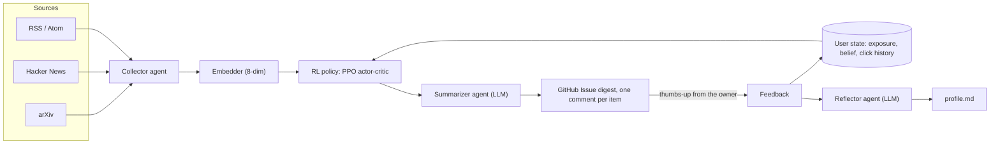
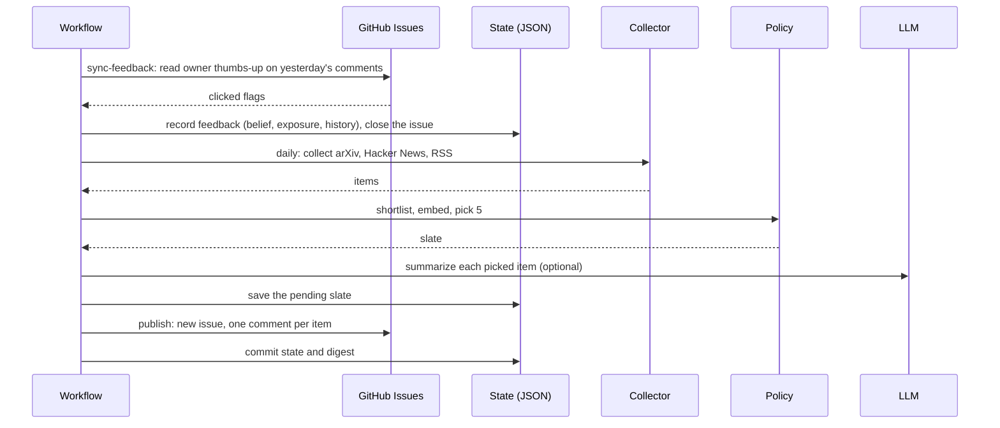

# Curio Documentation

Technical documentation for **Curio**, a multi-agent feed curator that learns a reader's
taste with reinforcement learning, together with the simulation study used to test whether
RL actually beats a well-tuned bandit for this task.

This is the reference document. For a short overview and the headline findings, see the
[README](../README.md). Reference links in section 17 were checked on 2026-11-14.

## Contents

1. [Overview](#1-overview)
2. [Concepts and glossary](#2-concepts-and-glossary)
3. [Architecture](#3-architecture)
4. [Installation and configuration](#4-installation-and-configuration)
5. [Simulation environments](#5-simulation-environments)
6. [Algorithms](#6-algorithms)
7. [Experiments and reproducibility](#7-experiments-and-reproducibility)
8. [Live pipeline](#8-live-pipeline)
9. [GitHub integration and automation](#9-github-integration-and-automation)
10. [Data formats](#10-data-formats)
11. [Module reference](#11-module-reference)
12. [Testing](#12-testing)
13. [Security and privacy](#13-security-and-privacy)
14. [Troubleshooting](#14-troubleshooting)
15. [Limitations and future work](#15-limitations-and-future-work)
16. [Change history](#16-change-history)
17. [References](#17-references)

---

## 1. Overview

Curio does two things.

1. **A working pipeline.** Every day it collects candidate items (papers, articles) from
   arXiv, Hacker News and RSS/Atom feeds, picks a slate of five with a PPO actor-critic
   policy, summarizes them with an LLM agent, posts them as a GitHub Issue, and learns from
   the owner's thumbs-up reactions.
2. **A study.** A set of simulators and tuned baselines that ask: *when does RL really help
   a feed recommender?* The answer so far is honest and modest: RL is competitive with a
   well-tuned, well-informed contextual bandit, but no setting showed it clearly winning.

The two parts are connected: the policy used in the live pipeline
(`models/curio_policy.pt`) is the PPO agent trained in the long-horizon simulator.

**Status.** Research prototype. The study is complete and reproducible. The live pipeline is
tested offline and against the real GitHub API, but has not yet run against the live arXiv,
Hacker News or Anthropic APIs, nor on GitHub Actions (see
[Limitations](#15-limitations-and-future-work)).

---

## 2. Concepts and glossary

| Term | Meaning in this project |
|---|---|
| **Slate** | The small set of items shown together (5 per day). |
| **Episode** | One simulated user's run: one day in the one-day environment, up to 7 days in the long-horizon one. |
| **MDP** | Markov decision process: states, actions, rewards, transitions, discount. The formal frame for RL. |
| **PPO** | Proximal Policy Optimization, the policy-gradient algorithm used for training ([ref 1](#17-references)). |
| **GAE** | Generalized Advantage Estimation, the variance-reduction scheme used with PPO ([ref 2](#17-references)). |
| **Actor-critic** | A policy network (actor) and a value network (critic) trained together. |
| **Contextual bandit** | A one-step decision model that picks an item given features and learns from the immediate reward only. |
| **LinUCB** | A contextual bandit with a linear reward model and an optimism bonus ([ref 3](#17-references)). |
| **CTR** | Click-through rate: clicks divided by items shown. |
| **Fatigue** | In the long-horizon simulator, showing items similar to recent exposure lowers the click probability, and the effect persists across days. |
| **Churn** | The simulated user leaves (the episode ends) when satisfaction falls below a threshold. |
| **Belief state** | A running estimate of the user's interest vector, computed from clicks (+1) and skips (-1) with ridge regression. |
| **Oracle** | A reference policy that is told the true hidden user state. It is an upper bound, not a fair competitor. |
| **Open loop** | Building a whole slate without seeing clicks between its items. This is how the live digest works. |
| **Paired difference** | A comparison of two methods on identical evaluation users per seed. |
| **Validation seeds** | Seeds (100-102) used only to tune baselines, never to evaluate them. |

---

## 3. Architecture



### One daily cycle



### Design principles

- **Everything that touches the network is injectable** (`http_get`, `transport`, an LLM
  client), so each component is tested offline.
- **Graceful degradation.** A failing source never stops the run; a missing or failing LLM
  falls back to extractive summaries and keyword profiles.
- **Untrusted input.** Item text from the internet is treated as data, never as instructions
  (section 13).
- **Honest evaluation.** Baselines are tuned on separate seeds and given the same
  information as the learned policy (section 7).

---

## 4. Installation and configuration

### Requirements

- Python 3.10 or newer. Development and tests ran on Python 3.12; the workflow template
  asks for 3.11, which has not been exercised.
- The packages in `requirements.txt`: `gymnasium`, `numpy`, `torch`, `matplotlib`, `pytest`,
  `defusedxml`.
- Optional: `anthropic` (LLM agents) and `sentence-transformers` (`--embedder sbert`).

The package is not pip-installable; run everything with `PYTHONPATH=src`.

```bash
git clone https://github.com/MHanzala74/Curio && cd Curio
python -m venv .venv && source .venv/bin/activate
pip install -r requirements.txt
export PYTHONPATH=src
pytest -q
```

### Environment variables

| Variable | Used by | Purpose |
|---|---|---|
| `ANTHROPIC_API_KEY` | `curio.llm.default_llm` | Enables LLM summaries and profiles. If unset, extractive and keyword fallbacks are used. |
| `CURIO_MODEL` | `AnthropicClient` | Overrides the default model name (`claude-sonnet-5-5`). |
| `GITHUB_TOKEN` | `publish`, `sync-feedback` | Token for the GitHub REST API (provided automatically in Actions). |
| `GITHUB_REPOSITORY` | `publish`, `sync-feedback` | `owner/name` of the repository holding the digest issues. |
| `GITHUB_REPOSITORY_OWNER` | feedback filter | Whose reactions count. Overridable with `--feedback-user`. |

### Sources configuration

`daily` reads a JSON file passed with `--config`. Defaults (`DEFAULT_CONFIG` in
`collector.py`):

```json
{
  "arxiv": {"categories": ["cs.AI", "cs.LG", "cs.CL"], "max_results": 30},
  "hackernews": {"limit": 30},
  "rss": []
}
```

Set a key to `null` to disable a source; add feed URLs to `rss`.

---

## 5. Simulation environments

Both environments follow the Gymnasium API ([ref 5](#17-references)): `reset`, `step`,
`observation_space`, `action_space` (`Discrete(pool_size)`), plus `action_masks()`.
In both, one **action** picks one candidate from a pool of `pool_size = 30` unit vectors of
dimension `dim = 8`; an episode builds a slate item by item; picked items become unavailable.
`FeedEnv` gives reward -1 for an already-picked item. `LongTermFeedEnv` does not check:
it relies on action masking, which the actor-critic and every baseline apply.

### 5.1 `FeedEnv` (one-day slates)

File: `src/curio/env.py`, with the user model in `src/curio/simulated_user.py`.

| Parameter | Default | Meaning |
|---|---|---|
| `pool_size` | 30 | Candidates per episode. |
| `slate_size` | 5 | Items picked per episode. |
| `dim` | 8 | Embedding dimension. |
| `novelty_weight` | 0.3 | Weight of the novelty bonus in the reward. |
| `click_feedback` | `False` | Put clicked/skipped summaries in the observation. |
| `belief_state` | `False` | Also put the ridge belief in the observation (needs `click_feedback`). |
| `resample_user_every` | `None` | Draw a new user every N episodes (1 = new user each episode). |

**User model (`SimulatedUser`).** For an item `x` with similarity `s = interest . x` and
`m` = the largest similarity to items already shown in the episode:

```
click probability = sigmoid(3 * s - 1.5 * m)        (default boredom_decay = 0.15)
novelty           = 1 - m                           (1 if nothing shown yet)
on click:  interest <- normalize(0.95 * interest + 0.05 * x)
```

**Reward:** `1[click] + novelty_weight * novelty`.

**Observation** (length `4*dim + pool*dim + pool = 302` by default):

```
[ shown mean | clicked mean | skipped mean | belief | pool (30 x 8, flattened) | availability (30) ]
```

`clicked`/`skipped` are zeros unless `click_feedback=True`; `belief` is zeros unless both
`click_feedback` and `belief_state` are true.

### 5.2 `LongTermFeedEnv` (7 days, fatigue and churn)

File: `src/curio/env_longterm.py`. This is the environment the live policy was trained on.

| Parameter | Default | Meaning |
|---|---|---|
| `days` | 7 | Maximum horizon. |
| `slate_size` | 5 | Items per day. |
| `fatigue` | 2.5 | Strength of the fatigue penalty. |
| `exposure_decay` | 0.97 | Per-item decay of the exposure vector. |
| `drift_rate` | 0.15 | How far interest moves toward a clicked item. |
| `sat_decay` | 0.6 | Smoothing of the satisfaction average. |
| `churn_threshold` | 0.5 | Churn if satisfaction falls below this at the end of a day. |

**Hidden user dynamics (`LongTermUser`):**

```
click probability = sigmoid(3 * (interest . x) - fatigue * max(0, exposure . x))
after every shown item:  exposure <- exposure_decay * exposure + x
on click:                interest <- normalize((1 - drift) * interest + drift * x)
end of day:              satisfaction <- 0.6 * satisfaction + 0.4 * (clicks_today / 5)
                         churn (episode ends) if satisfaction < churn_threshold
```

Initial satisfaction is 0.6. A fresh pool is drawn each day and a new user each episode.

**Reward:** clicks only. Diversity pays off solely by keeping the user from churning.

**Observation** (length 305 by default):

```
[ exposure/3 (clipped) | clicked mean | skipped mean | belief ]      4 x 8 values
[ day/days | last day CTR | clicks so far / items so far ]           3 scalars
[ pool (30 x 8) | availability (30) ]
```

The agent cannot see satisfaction or the true interest; it can track exposure from what it
showed and infer interest from clicks.

---

## 6. Algorithms

### 6.1 Actor-critic (`curio.ppo.ActorCritic`)

The policy scores each candidate with a **shared MLP**, so it is invariant to the order of
the pool (the pool is re-drawn every episode).

- **Per-item features:** the summaries, the item, the item multiplied elementwise with each
  summary, the scalars, an availability flag, and (with `dot_features=True`)
  `item . summary` and `relu(item . summary)` for each summary. For the long-horizon
  environment with dot features that is 84 inputs.
- **Scorer:** two hidden layers of 64 `tanh` units, one output logit per item.
- **Action masking:** logits of unavailable items are set to -1e9 before the softmax.
- **Critic:** one hidden layer of 64 units on the summaries, scalars, mean of the available
  pool, and the fraction of the pool left.
- **Acting:** `act(obs, greedy=False)` samples; `greedy=True` takes the argmax and is used
  for evaluation and in the live pipeline.

### 6.2 PPO (`curio.ppo.PPO`)

Standard clipped-objective PPO ([ref 1](#17-references)) with GAE ([ref 2](#17-references)).

| `PPOConfig` field | Default | Notes |
|---|---|---|
| `gamma` | 0.9 | Experiments override this (0.99 for the long-horizon runs). |
| `gae_lambda` | 0.95 | |
| `clip_eps` | 0.2 | |
| `lr` | 3e-3 | Personalization and long-horizon experiments use 5e-4. |
| `epochs` | 4 | Per update. |
| `minibatch` | 128 | |
| `entropy_coef` | 0.01 | |
| `value_coef` | 0.5 | |
| `max_grad_norm` | 0.5 | |

Rollouts collect whole episodes (`curio.training.collect`); GAE runs over the flat
trajectory with done flags; advantages are normalized per update. Hitting the 7-day horizon
is treated as terminal, and the day fraction is part of the observation.

**Training helpers.**

- `train_ppo(seed, updates, episodes_per_update, ..., gamma, env_cls, **env_kwargs)`
- `train_ppo_chunked(...)` trains for at most `chunk` updates, saves model, optimizer and
  history to a checkpoint, and resumes from it on the next call, so long runs fit short
  execution limits. Random streams are re-seeded per chunk, so a chunked run is
  statistically equivalent to, not bit-identical with, an uninterrupted one.

### 6.3 Baselines (`curio.baselines`)

| Policy | Sees | Behaviour |
|---|---|---|
| `RandomPolicy` | nothing | Uniform over available items. |
| `OracleGreedyPolicy` | true interest | Picks the highest similarity; ignores novelty. |
| `OracleDiversePolicy(w)` | true interest | Similarity minus `w` times the largest similarity to recent items. |
| `OracleFatiguePolicy(extra)` | true interest and fatigue | `extra = 0`: maximizes the immediate click probability. `extra > 0`: also avoids exposure (a crude lookahead). |
| `LinUCBPolicy` | clicks it observed | Ridge regression `theta = A^-1 b` with `A = reg * I`; score `theta . x + alpha * sqrt(x A^-1 x)`. Options: `signed_reward` (a skip counts as -1 evidence) and `reset_each_episode` (a per-user bandit). |
| `FatigueAwareLinUCBPolicy` | clicks and its own exposure | LinUCB minus `beta * max(0, exposure . x)`, where exposure is tracked from the items it showed (never from hidden state). |

Oracles are references. The two LinUCB variants are the fair non-RL competitors.

### 6.4 Belief state

For an episode, `A = 0.1 I + sum(x x^T)` and `b = sum(y x)` with `y = +1` for a click and
`-1` for a skip. The belief is `clip(solve(A, b), -1, 1)`. The same update is used in the
simulator (`env.py`, `env_longterm.py`) and the live state (`live.py`).

---

## 7. Experiments and reproducibility

### 7.1 Protocol

- **Seeds.** For seed `s`, PPO is trained in an environment seeded `s` and evaluated in a
  *fresh* environment seeded `1000 + s`, so the evaluation users were never seen in training.
- **Evaluation.** 300 episodes per method and seed; PPO acts greedily. Metrics: mean episode
  return, CTR (clicks over items shown), and (long-horizon) mean days before churn.
- **Tuning.** Baselines are tuned on validation seeds 100-102, evaluated on seeds
  `2000 + s`, never on the evaluation seeds. Grids are extended until the optimum is
  interior. `docs/linucb_tuning.md` holds only the last round of the personalization grid.
- **Comparisons.** Methods share evaluation users per seed; results are reported as mean
  and standard deviation over seeds, with paired differences and the number of seeds won.

### 7.2 Scripts

| Script | Purpose | Variants / options | Outputs |
|---|---|---|---|
| `train.py` | Single-seed PPO vs baselines, one-day task | `--updates`, `--episodes-per-update`, `--seed` | `docs/results.md`, `docs/learning_curve.png` |
| `multi_seed.py` | 5-seed one-day comparison | `--seeds`, `--updates` | `docs/multi_seed_results.{md,json}`, `docs/multi_seed_curve.png` |
| `tune_linucb.py` | Tune per-user LinUCB on validation seeds | none | `docs/linucb_tuning.md` |
| `personalization.py` | New user every episode, 10-item slates | `--variant baselines / noclick / click / belief` | `docs/runs/<variant>_seed<N>.json` |
| `aggregate.py` | Table and plot for the personalization study | none | `docs/personalization_results.md`, `docs/personalization.png` |
| `long_horizon.py` | 7-day fatigue and churn study | `--variant baselines / ppo90 / ppo99 / ppo99dot`, `--total-updates`, `--chunk` | `docs/runs_long/<variant>_seed<N>.json` |
| `aggregate_long.py` | Table and plot for the long-horizon study | none | `docs/long_horizon_results.md`, `docs/long_horizon.png` |

### 7.3 Settings used

| Experiment | Environment | PPO settings |
|---|---|---|
| One-day (`multi_seed.py`) | `FeedEnv` defaults: fixed user, no click feedback | 120 updates, 64 episodes per update, lr 3e-3, gamma 0.9 |
| Personalization | `FeedEnv(slate_size=10, resample_user_every=1)` with the click and belief options | 200 updates, 128 episodes per update, lr 5e-4, gamma 0.9 |
| Long-horizon | `LongTermFeedEnv` defaults | 200 updates, 64 episodes per update, lr 5e-4, gamma 0.99 (`ppo90` uses 0.9) |
| Long-horizon follow-up (`ppo99dot`) | same, with `dot_features=True` | 400 updates (two chunks of 200) on seeds 0 and 1; script defaults are 600 and 300 |

Tuned baseline settings: personalization LinUCB `alpha=2.0, reg=0.1, signed`; long-horizon
LinUCB `alpha=8.0, reg=0.3, signed`; fatigue-aware LinUCB `alpha=0.5, beta=6.0,
decay=0.97, reg=0.3`; oracle-lookahead extra weight 3.0 (chosen on a separate seed).

### 7.4 Findings

Numbers are means over 3 seeds unless noted; full tables are in the README and in
`docs/*_results.md`.

1. **One-day task (5 seeds).** PPO 4.77 vs LinUCB 4.44 vs random 3.45. PPO won on every
   seed, but it kept a similar CTR on a user whose interest vector had cosine similarity
   -0.5 with the training user, so it had learned a **user-agnostic diversity strategy**, not
   personalization.
2. **Personalization.** Click feedback improves PPO (6.64 to 6.89, about +0.25, 3/3 seeds).
   A tuned LinUCB (6.92) **ties** PPO with belief state (6.97). An earlier claim that PPO
   won came from an untuned baseline (6.12) and was corrected.
3. **Long-horizon.** PPO (8.41 clicks) beats a fatigue-unaware bandit (5.74), but a
   **fatigue-aware bandit scores 11.70** (oracle ceiling about 14.85). Discount 0.9 vs
   0.99 made no difference, and the lookahead oracle was barely better than the myopic one.
4. **Follow-up (2 seeds, preliminary).** With dot features and longer training PPO reaches
   about 11.8 versus about 11.9 for the fatigue-aware bandit on the same seeds: roughly a tie.

**Conclusion.** Competitive, not superior. The advantages seen early on were explained by
the baselines lacking information (novelty, click feedback, fatigue) or tuning. This does not
show that RL cannot win; harder and longer-horizon settings remain untested.

### 7.5 Reproducibility notes

- The one-day results were produced with the code at tag `v0.1-no-click-feedback`. The
  observation layout has since changed (it gained click, skip and belief summaries), so
  rerunning `multi_seed.py` today gives similar but not identical numbers.
- Chunked training is not bit-identical to uninterrupted training (section 6.2).
- Runs used CPU PyTorch. Per-seed run files in `docs/runs/` and `docs/runs_long/` contain
  the raw evaluation results and training curves behind every table.

---

## 8. Live pipeline

### 8.1 Command line

`python -m curio.cli <command>` (with `PYTHONPATH=src`).

| Command | What it does |
|---|---|
| `daily` | Collect, shortlist, embed, pick the slate, summarize, write `digest/<date>.md`, save the pending slate. |
| `publish` | Post the pending slate as a GitHub Issue (one comment per item) and remember the issue and comment IDs. |
| `sync-feedback` | Read the owner's thumbs-up reactions on the last digest, update the user state, close the issue. |
| `feedback` | Offline alternative to `sync-feedback`: `--clicked 1 3` gives the 1-based numbers of the items you read. |
| `reflect` | Write `profile.md` from the recent feedback log. |

Flags shared by every command: `--state` (default `state/live_state.json`), `--date`
(default today), `--offline` (never call an LLM).

| Command | Extra flags |
|---|---|
| `daily` | `--demo` (bundled synthetic items, no network), `--config`, `--model` (default `models/curio_policy.pt`), `--embedder {hashing,sbert}`, `--slate-size` (5), `--out` (`digest`) |
| `feedback` | `--clicked N [N ...]` |
| `publish`, `sync-feedback` | `--repo owner/name`, `--feedback-user LOGIN` |
| `reflect` | `--profile` (`profile.md`), `--window` (100 records) |

Exit codes: `0` on success; `1` when there is nothing to do and that is an error
(`daily` collected no items; `feedback` or `publish` found no pending digest).
`sync-feedback` with nothing awaiting feedback exits `0`.

Offline walk-through:

```bash
export PYTHONPATH=src
python -m curio.cli daily --demo --offline
python -m curio.cli feedback --clicked 1 3
python -m curio.cli reflect --offline
```

### 8.2 What `daily` does

1. Load the state. If a slate is still pending (no feedback arrived), count its items as
   **ignored** and print a note.
2. Collect items (`--demo` reads `data/sample_items.json`). Source errors are printed as
   warnings. No items at all: exit 1.
3. **Shortlist** to the policy's pool size (30): round-robin over sources so one busy source
   cannot crowd out the others (`live.shortlist`).
4. **Embed** `title + summary` of each item into 8 dimensions.
5. **Select** the slate with the policy (greedy, open loop; section 8.4).
6. **Summarize** each picked item.
7. Write the digest, store the slate as pending in the state, save the state.

### 8.3 Embeddings

`HashingEmbedder` (default, offline, deterministic): lowercase word tokens matching
`[a-z][a-z0-9-]{2,}` minus a stop-word list; each token is hashed (MD5) into one of 2048
buckets with a hash-derived sign; counts are damped with `sign * log(1 + |count|)`; a fixed
random projection (seed 0) maps the 2048-dimensional vector to 8 dimensions; rows are
L2-normalized.

`SentenceTransformerEmbedder`: encodes with a sentence-transformers model
(`all-MiniLM-L6-v2` by default, based on Sentence-BERT, [ref 6](#17-references)) and projects
to 8 dimensions with a fixed random projection.

Both are lossy at 8 dimensions. They bridge real text and a policy trained on synthetic
vectors; they are not a claim of good semantic coverage.

### 8.4 Policy inference

`SlateBuilder.build_obs` produces the **exact** observation layout of `LongTermFeedEnv`
(a test checks equality against the simulator, including after a step). `select` then picks
up to `slate_size` distinct indices greedily: after each pick it marks the item unavailable
and adds it to a temporary exposure vector.

Differences from training:

- **Open loop.** In training the policy saw a click or skip after every item; a real digest
  gets feedback only after the whole slate is shown. Clicked and skipped summaries and the
  belief therefore do not change within a digest.
- **No forgetting.** The belief accumulates forever, and the day counter saturates at 7.
- **Different items.** Real text is embedded to 8 dimensions with the hashing embedder.

### 8.5 State and feedback semantics

| Constant (`live.py`) | Value | Meaning |
|---|---|---|
| `EXPOSURE_DECAY` | 0.97 | Same as the simulator. |
| `HORIZON_DAYS` | 7 | `day / 7` is an observation scalar; `day` saturates at 7. |
| `MAX_HISTORY` | 50 | Clicked and skipped vectors kept for the summaries. |
| `BELIEF_PRIOR` | 0.1 | Ridge prior of the belief. |

`record_feedback` applies each pending item in order (`LiveState.apply`: exposure, belief,
clicked/skipped lists, totals), appends to `feedback_log` (capped at 500), sets the day's
CTR, and advances the day. Items not marked clicked count as ignored.

### 8.6 Agents

**Collector** (`collector.py`).

- *arXiv:* one request to the Atom API, sorted by submission date, newest first. The manual
  asks clients to cache results and to space out calls; Curio makes a single request per run.
- *Hacker News:* `topstories` then one request per story. The list also contains job posts;
  items that are not `story`, or are dead or deleted, are dropped. Item text is HTML and is
  stripped.
- *RSS/Atom:* both formats are parsed. Item ids are `rss:<host>:<guid>`.
- *All sources:* titles are capped at 300 characters, text at 1500, tags stripped, items
  de-duplicated by id and URL, empty titles dropped. XML is parsed with `defusedxml`.

**Summarizer** (`agents.Summarizer`). With an LLM client it sends the item inside `<item>`
tags with a system prompt that marks the text as untrusted data, asks for two short
sentences, and cleans the reply (HTML stripped, 500 characters). On a missing client, an
error, or an empty reply it falls back to the first two sentences of the item text (or the
title).

**Reflector** (`agents.Reflector`). With an LLM client it sends the previous profile and the
titles of clicked and ignored items (each list capped at 3000 characters, inside
`<clicked>` and `<ignored>` tags, again as untrusted data) and asks for a Markdown profile
with Likes, Dislikes and Notes sections. The fallback scores every title word by
`clicked rate - ignored rate` and lists the top 8 of each.

**LLM client** (`llm.py`). `AnthropicClient.complete(system, prompt, max_tokens)` calls the
Messages API ([ref 10](#17-references)) with the system prompt in the top-level `system`
field. The LLM is given no tools and cannot take actions; it only produces text that is
displayed.

---

## 9. GitHub integration and automation

### 9.1 Feedback through Issues

`publish` creates an issue titled `Curio digest <date>` (label `curio-digest`) and one
comment per item (`### n. title`, source and URL, summary). The comment IDs are stored in the
state (`pending_issue`), so feedback is read from known comments and nothing is parsed out of
comment text.

`sync-feedback` lists the **thumbs-up (`+1`) reactions** on each stored comment and counts an
item as clicked only if the reactor's login equals the repository owner (case-insensitive;
`--feedback-user` overrides). The reaction listing is filtered to `+1` and paginated at 100
per page (up to 10 pages), because a crowd of strangers' reactions on a public repository
could otherwise push the owner's reaction off the first page. The API's reaction types and
paging limits are described in [ref 9](#17-references). The state is saved **before** the
issue is closed, so a failed close cannot lose feedback.

### 9.2 The daily workflow

The template is `deploy/daily.yml` (see 9.3 for why it is not under `.github/`). It runs
daily at 04:00 UTC and on manual dispatch, guarded by the repository variable
`CURIO_ENABLED == 'true'`:

1. `sync-feedback`: read yesterday's reactions. If this fails the job stops, so unread
   feedback is never silently counted as ignored.
2. `daily`, then `publish`.
3. On Sundays, `reflect`.
4. `bash deploy/commit_state.sh`: stage only the paths that exist among `state`, `digest`
   and `profile.md`, commit if anything changed, push.

Permissions are `contents: write` and `issues: write`; runs are serialized with a
`concurrency` group; the job has a 20 minute timeout. Optional secret: `ANTHROPIC_API_KEY`.

### 9.3 Setup

1. **Copy the workflow.** Add `deploy/daily.yml` as `.github/workflows/daily.yml` using the
   GitHub web UI (Add file, Create new file) or a normal `git push` from your machine.
   It is kept outside `.github/` because GitHub rejects pushes that add or change workflow
   files unless the token has the `workflow` scope.
2. **Enable it.** Settings, Secrets and variables, Actions, Variables: set
   `CURIO_ENABLED` to `true`. Optionally add the secret `ANTHROPIC_API_KEY`.
3. **Test it.** Actions tab, "Curio daily digest", Run workflow.
4. **Give feedback.** Put a thumbs-up on the comment of each item you want more of.

### 9.4 Token permissions

- In Actions the built-in `GITHUB_TOKEN` is enough (permissions above).
- For local runs with a personal access token: a classic token with `repo` scope, or a
  fine-grained token limited to the repository with Issues read and write. Pushing a workflow
  file additionally needs the `workflow` scope or the fine-grained Workflows permission.
- Never commit a token. Keep it in an environment variable or a CI secret, and revoke any
  token that was pasted into a chat or log.

### 9.5 Privacy

The workflow commits `state/live_state.json` and `digest/`, which record what you were
shown and what you clicked. In a public repository this is your reading history. For
personal use, run the workflow in a **private copy** of the repository.

---

## 10. Data formats

**`Item`** (`collector.Item`, JSON object):

```json
{"id": "arxiv:2601.00001v1", "title": "...", "summary": "...", "source": "arxiv",
 "url": "http://arxiv.org/abs/2601.00001v1", "published": "2026-01-02T00:00:00Z"}
```

Id prefixes: `arxiv:<id>`, `hn:<id>`, `rss:<host>:<guid>`; demo items use `sample:<n>`.

**`LiveState`** (`state/live_state.json`):

| Field | Meaning |
|---|---|
| `dim` | Embedding dimension (8). |
| `exposure` | Decayed sum of shown item vectors. |
| `belief_A`, `belief_b` | Ridge statistics of the belief (`A` starts at `0.1 I`). |
| `clicked`, `skipped` | Last 50 clicked and skipped vectors. |
| `day`, `last_day_ctr` | Day counter (saturates at 7) and the previous digest's CTR. |
| `total_clicks`, `total_shown` | Running totals. |
| `pending` | Slate awaiting feedback: `[{"item": {...}, "vec": [...], "summary": "..."}]`. |
| `pending_issue` | `{"number": int, "comment_ids": [int, ...]}` or `null`. |
| `feedback_log` | Up to 500 records `{"date", "id", "title", "source", "clicked"}`. |

**Digest** (`digest/<date>.md`): a `# Curio digest, <date>` heading, then per item
`## n. title`, a line `*source* | url`, and the summary, followed by a footer explaining how to
give feedback.

**Run files** (`docs/runs/*.json`, `docs/runs_long/*.json`):
`{"results": {"<method>": {"return": float, "ctr": float, "days": float}}, "train_curve": [...]}`;
baseline files also store the tuned hyperparameters.

**Policy file** (`models/curio_policy.pt`): a dictionary with `state_dict`, `config`
(`pool_size, dim, n_summaries, n_scalars, dot_features`), `trained_updates` and a note. It is
loaded with `torch.load(..., weights_only=True)`. It is the seed-0 checkpoint of the PPO run
with similarity features.

---

## 11. Module reference

| Module | Purpose | Main public API |
|---|---|---|
| `curio.env` | One-day slate environment | `FeedEnv` |
| `curio.simulated_user` | Drifting user with boredom | `SimulatedUser` |
| `curio.env_longterm` | 7-day environment with fatigue and churn | `LongTermFeedEnv`, `LongTermUser` |
| `curio.ppo` | Actor-critic and PPO | `ActorCritic`, `PPOConfig`, `PPO` |
| `curio.training` | Rollouts and training loops | `collect`, `train_ppo`, `train_ppo_chunked` |
| `curio.baselines` | Reference and baseline policies | `RandomPolicy`, `OracleGreedyPolicy`, `OracleDiversePolicy`, `OracleFatiguePolicy`, `LinUCBPolicy`, `FatigueAwareLinUCBPolicy` |
| `curio.evaluate` | Evaluation loops | `run_policy`, `run_ppo` |
| `curio.collector` | Collector agent | `Item`, `collect`, `fetch_arxiv`, `fetch_hackernews`, `fetch_rss`, `parse_arxiv`, `parse_hn_item`, `parse_feed`, `clean_text` |
| `curio.embedding` | Item embeddings | `HashingEmbedder`, `SentenceTransformerEmbedder`, `tokenize` |
| `curio.llm` | LLM client abstraction | `LLMClient`, `AnthropicClient`, `default_llm` |
| `curio.agents` | Summarizer and Reflector | `Summarizer`, `Reflector`, `extractive_summary` |
| `curio.live` | Live state and slate building | `LiveState`, `SlateBuilder`, `load_policy`, `shortlist`, `start_day`, `record_feedback` |
| `curio.github_io` | GitHub Issues feedback channel | `GitHubClient`, `publish_digest`, `collect_issue_feedback`, `safe_markdown` |
| `curio.cli` | Command line | `main`, `build_parser` |

Entry points and signatures follow the source; the module docstrings describe each piece in
more detail.

---

## 12. Testing

Run `PYTHONPATH=src pytest -q`. 57 tests, no network needed.

| File | Tests | Covers |
|---|---|---|
| `test_env.py` | 9 | Shapes, episode length, invalid actions, reproducibility, click feedback, belief, user resampling |
| `test_env_longterm.py` | 4 | Termination, click-only reward, fatigue, churn |
| `test_ppo.py` | 5 | GAE against a manual computation, masking, parameter updates, dot features, checkpoint resume |
| `test_baselines.py` | 4 | Oracle and LinUCB sanity, diversity oracle, fatigue-aware exposure tracking |
| `test_collector.py` | 7 | arXiv, Hacker News and RSS/Atom parsing, de-duplication, failing sources |
| `test_agents.py` | 8 | Embedder, summarizer and reflector with fake LLMs, fallbacks, untrusted-data framing |
| `test_live.py` | 7 | State round trip, observation parity with the simulator, selection, shortlist, feedback, offline end to end |
| `test_github_feedback.py` | 8 | Publishing, owner-only reactions, pagination, error handling, publish and sync round trip |
| `test_deploy.py` | 2 | Commit script in a real git repository (regression for a staging bug) |
| `test_docs.py` | 3 | Documentation links resolve; every CLI command and module is documented |

Not covered by tests: calls to the live arXiv, Hacker News and Anthropic APIs, and
execution of the workflow on GitHub Actions. The GitHub Issues loop was additionally checked
against the real API with a manual smoke test and a rehearsal of the CLI sequence.

---

## 13. Security and privacy

| Concern | Mitigation |
|---|---|
| **Prompt injection** from item text ([ref 11](#17-references)) | Item text is delimited (`<item>`, `<clicked>`, `<ignored>`), length-capped, and the system prompts state it is untrusted data. The LLM has no tools, so the worst case is a misleading summary. Delimiting reduces but cannot eliminate this risk. |
| **Malicious XML** in feeds | Parsed with `defusedxml`; HTML is stripped from all text. |
| **Mention spam** | `@` is neutralized in text posted to GitHub. |
| **Feedback poisoning** on a public repository | Only the owner's thumbs-up counts; reactions are paginated so crowding cannot hide the owner's. Comment IDs are stored, not parsed from comments. |
| **Unsafe model files** | The policy and checkpoints load with `weights_only=True`. Still, load only files you trust. |
| **Secrets** | Tokens come from environment variables or CI secrets and are never written to the repository or git config. Revoke any token exposed in a chat or log. |
| **Lost feedback** | `sync-feedback` saves state before closing the issue, and the workflow stops if reading feedback fails. |
| **Privacy** | The workflow commits click history; use a private repository for personal data. |
| **Network etiquette** | One arXiv request per run, a descriptive `User-Agent`, 15 second timeouts for collectors and 30 seconds for GitHub calls. |

---

## 14. Troubleshooting

| Symptom | Cause and fix |
|---|---|
| Push rejected: "refusing to allow a Personal Access Token to create or update workflow ... without `workflow` scope" | GitHub requires that scope to add workflow files. Add the file in the web UI, or push with a token that has the scope. |
| Workflow shows "skipped" | The variable `CURIO_ENABLED` is not `true`. |
| `No published digest awaiting feedback.` | No `publish` ran since the last sync, or feedback was already recorded. This is normal on the first day. |
| `No pending digest. Run daily first.` | `feedback` or `publish` was called before `daily`. |
| Thumbs-ups are not counted | The reaction must be `+1` on an **item comment** (not the issue body), by the owner login. For a repository in an organization or a fork, pass `--feedback-user`. With a fine-grained token, Issues read permission is needed to list reactions. |
| Summaries look extractive | `ANTHROPIC_API_KEY` is unset, the `anthropic` package is missing, or the call failed. This is the intended fallback. |
| `collector warning: ...` | One source failed; the others still ran. Check connectivity and the feed URL. |
| arXiv returns few or no items | The API only exposes new articles once a day and asks for caching; try again later and keep to one request per run. |
| Slates contain near-duplicate topics | Expected with the crude 8-dimensional embedding and open-loop slates (section 15). |
| Slow or failing torch install in Actions | The CPU wheel is large. Check the install step log; the workflow uses the PyTorch CPU index. |
| `ModuleNotFoundError: curio` | Run with `PYTHONPATH=src`. |

---

## 15. Limitations and future work

**Limitations**

- **Simulation only for the RL claims.** The simulated users are simple and their constants
  (fatigue, drift, churn threshold) were chosen by hand.
- **Few seeds.** 3 seeds (2 for the last follow-up), so standard deviations are rough and
  small gaps are not meaningful.
- **Sim-to-real gap.** The policy was trained on 8-dimensional synthetic items; real text is
  embedded crudely, and slates are built open loop.
- **No real-user evaluation.** Whether the live ranking matches a real person's taste needs
  weeks of actual use.
- **Untested integrations.** Live arXiv, Hacker News and Anthropic calls and the Actions
  workflow have not been run end to end.
- **Privacy** of committed state in public repositories (section 9.5).

**Future work**

- First real run of the workflow and live APIs; fix whatever surfaces.
- Several weeks of real feedback to evaluate the live ranking.
- Better embeddings and a policy retrained on realistic item features.
- Closed-loop feedback per item, or retraining on logged real feedback.
- More seeds for the PPO versus bandit follow-up, and harder settings (longer horizons,
  richer user models) where RL might win.

---

## 16. Change history

Corrections are part of the record. Commit hashes refer to this repository.

| Commits | Change |
|---|---|
| `ee6db91`, `15435f7` | Scaffold; Gymnasium slate environment and drifting simulated user. |
| `9ee82f3` | PPO from scratch and baselines. Early claim: PPO beats the bandit. |
| `92c379b` | 5-seed study. Finding: PPO had learned a user-agnostic diversity strategy, not personalization (tag `v0.1-no-click-feedback`). |
| `a502165`, `d62a297`, `0c865cc` | Click feedback, belief state, per-episode users. **Correction:** a claimed large PPO win over LinUCB came from an untuned baseline; the tuned bandit ties PPO. |
| `b080834`, `8e8ddd0`, `606c36d`, `0ed7577` | Long-horizon environment. **Correction:** PPO's win over a fatigue-unaware bandit disappeared against a fatigue-aware one. |
| `3f54879`, `dcde443` | PPO with similarity features and longer training roughly ties the fatigue-aware bandit (2 seeds). |
| `d452453`, `3ce1ff7`, `9368e4d`, `3dc65a5` | Collector, agents, live pipeline, GitHub Issue feedback and workflow template. |
| `caca71a` | **Fix:** the workflow's commit step staged nothing until `profile.md` existed; moved into a tested script. |
| this documentation commit | Reaction pagination with a `+1` filter; model and checkpoint loading with `weights_only=True`; this document. |

---

## 17. References

Reference details and links were checked on 2026-11-14.

**Algorithms and methods**

1. J. Schulman, F. Wolski, P. Dhariwal, A. Radford, O. Klimov. *Proximal Policy Optimization
   Algorithms.* arXiv:1707.06347, 2017. <https://arxiv.org/abs/1707.06347>
2. J. Schulman, P. Moritz, S. Levine, M. Jordan, P. Abbeel. *High-Dimensional Continuous
   Control Using Generalized Advantage Estimation.* arXiv:1506.02438, 2015.
   <https://arxiv.org/abs/1506.02438>
3. L. Li, W. Chu, J. Langford, R. E. Schapire. *A Contextual-Bandit Approach to Personalized
   News Article Recommendation.* WWW 2010, pp. 661-670. arXiv:1003.0146.
   <https://arxiv.org/abs/1003.0146>, DOI <https://doi.org/10.1145/1772690.1772758>
4. E. Ie, V. Jain, J. Wang, S. Narvekar, R. Agarwal, R. Wu, H.-T. Cheng, T. Chandra,
   C. Boutilier. *SlateQ: A Tractable Decomposition for Reinforcement Learning with
   Recommendation Sets.* IJCAI 2019, pp. 2592-2599. <https://doi.org/10.24963/ijcai.2019/360>
   (extended version: arXiv:1905.12767, <https://arxiv.org/abs/1905.12767>). Related work on
   slate-based RL for recommendation.
5. M. Towers et al. *Gymnasium: A Standard Interface for Reinforcement Learning
   Environments.* arXiv:2407.17032 (accepted at the NeurIPS Datasets and Benchmarks track
   2025, per the arXiv record). <https://arxiv.org/abs/2407.17032>
6. N. Reimers, I. Gurevych. *Sentence-BERT: Sentence Embeddings using Siamese BERT-Networks.*
   EMNLP 2019. arXiv:1908.10084. <https://arxiv.org/abs/1908.10084>

**APIs and documentation**

7. arXiv API User's Manual. <https://info.arxiv.org/help/api/user-manual.html>
8. Hacker News API (official documentation and samples). <https://github.com/HackerNews/API>
9. GitHub REST API, Reactions. <https://docs.github.com/en/rest/reactions>
10. Claude API, Messages API (`POST /v1/messages`). <https://platform.claude.com/docs/en/api>

**Security**

11. OWASP Top 10 for LLM Applications, LLM01 Prompt Injection (including indirect injection
    through external content). <https://genai.owasp.org/llm-top-10/>

**Libraries**

- PyTorch: <https://pytorch.org>
- NumPy: <https://numpy.org>
- Gymnasium: <https://gymnasium.farama.org>
- defusedxml: <https://pypi.org/project/defusedxml/>
- sentence-transformers: <https://github.com/UKPLab/sentence-transformers>
